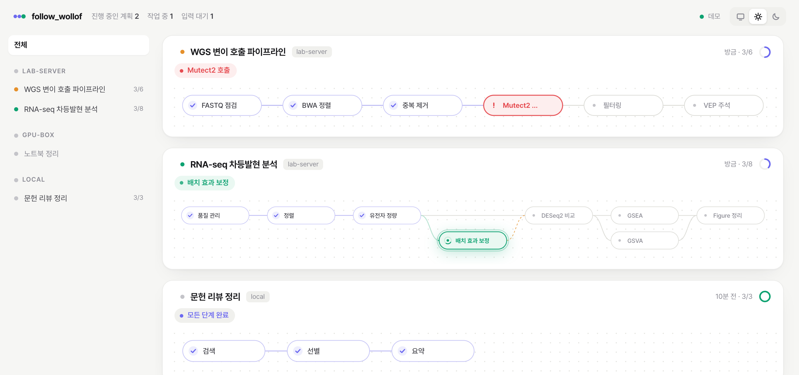

# follow_wollof

[한국어](README.ko.md)

A small dashboard for keeping an eye on Claude Code sessions spread across several machines.

I usually have a few long analyses running at once, on my laptop and on a couple of servers. Each Claude Code session starts by laying out a plan and then works through it, and after switching to something else for a while I lose track of which session is where. follow_wollof draws each session's plan as a graph and marks the step it is on, updating live. When a plan changes halfway, the new step shows up branching off the step it came from and joining the step it feeds into, so you can still tell how the plan got to where it is.



*Sample data. The UI is in Korean.*

## How it works

Each session records its plan with a small CLI, `follow.py`. Every call appends a line to `~/.follow_wollof/sessions/<session-id>/events.jsonl`, so nothing is overwritten and the history of the plan stays around. A block in the global `CLAUDE.md` asks Claude to do this for multi-step work, and a Stop hook nudges it once if a turn ends without an update.

The dashboard server keeps one SSH connection per host and sends a small watcher script over it, so a server needs nothing installed just to be watched. The watcher reads Claude Code's own session files in `~/.claude/sessions` along with the plan logs, and reports changes every couple of seconds.

It is plain Python with no third-party packages.

## Requirements

- Python 3.8+ on the computer that shows the dashboard (macOS, Linux or Windows), Python 3.6+ on servers
- Claude Code on every host you want to follow
- SSH key login to remote hosts: `ssh <host> true` should finish without asking anything

## Setup

```bash
git clone https://github.com/Sejung98/follow_wollof.git
cd follow_wollof
./fw init        # creates config.ini
```

On Windows, run `fw.cmd` wherever this page says `./fw`.

List your hosts in `config.ini`. Everything else has a default.

```ini
[host:local]
type = local

[host:lab-server]
type = ssh
ssh = lab-server   ; Host alias from ~/.ssh/config, or user@hostname
```

Then:

```bash
./fw check     # can every host be reached?
./fw deploy    # install the session tools on each host
./fw           # start the server and open http://localhost:7777
```

`deploy` puts `follow.py` and the Stop hook in `~/.follow_wollof/bin`, adds a `/follow` skill, one marked block to `~/.claude/CLAUDE.md` and one Stop hook entry to `~/.claude/settings.json`. Both files are backed up the first time. `./fw deploy --uninstall` takes it all out again.

`./fw autostart on` starts the server at login (launchd, a systemd user service, or the Windows Startup folder).

`./fw shortcut on` adds a launcher icon: `~/Applications` and the Dock on macOS, the Desktop and Start menu on Windows, the applications menu on Linux. It runs `fw window`, which starts the server if needed and opens the dashboard in a window of its own, without tabs or address bar (Chrome or Edge app mode; a browser tab otherwise). `--no-dock` leaves the Dock alone, `./fw shortcut off` removes it. Run it again after moving the folder.

## Projects and notifications

Add a `[project:<name>]` section per project to `config.ini`, one key per host naming that host's folder(s) for it (`data = 00_raw_data, 02_data` optionally names the data folders). The **Projects** view, the first tab, has two parts. The session ontology is a mind map: the project in the middle, its sessions from every computer on either side (the computer is only a label), and what each one is doing, taken from its follow plan, else Claude's own to-do list, else the requests it was given, with any subagents alongside. Steps flow outward from their session in causal order: a step sits after the steps it waits for, steps that can run together share a column, and the flow wraps to a new line every three columns. Boxes can be dragged anywhere; groups pushed into each other move aside. Running paths march, waiting ones pulse amber. Selecting a session shows which data it reads (data-folder paths in its conversation, or its report) flowing into it. The data catalog groups the project's data folders by kind (DNA, RNA, protein, spatial, single-cell, clinical, external cohorts, reference) with stage, formats, estimated samples, size, last change and the analyses that use each. Folders are re-read every 15 minutes or on `다시 읽기`; only names, sizes and dates are read.

Click an analysis for its flow: the data it read (from the paths its `REPORT.md` quotes; guessed from names otherwise, drawn dashed), its plan steps or scripts, the tables and figures it made, and the checks it ended on with their verdicts. A finished analysis plays through once; a running one keeps data flowing into its current step and shows new files in its `daily_analysis/<date>/<slug>/` folder as they appear.

**Questions & to-dos** collects what comes up in meetings or reading, per project and theme, on one page. Type or paste a memo; the Claude Code on this computer (a small model with tools and settings off, about a tenth of a cent) splits it into questions and to-dos and files each one. The list lives in one file on the `[todo] host`, so every desktop sees the same; checked items stay with their completion time and show with `완료한 것도 보기`. Analyses that look related are suggested under each item; linking one makes it open that analysis' flow. Meeting notes, comments and feedback trackers in the project folders are read for what is still open; imported items are checked against later analysis reports and the server's question log, and the ones clearly dealt with are closed with the report as evidence. Each project's server-side `analysis_backlog` and question log (`claude-daily-log/QUESTIONS.md`) show alongside, read-only.

The server also raises a desktop notification (macOS Notification Center, a Windows toast that opens the session, or `notify-send`) when a session ends, stops after working for over a minute, waits for input, hits a blocked step, or stalls for two hours. Tune it in `[notify]` and try it with `./fw notify`.

## Usage

New sessions start recording on their own once they take on something with several steps. In a session that was already open, type `/follow`.

You can also call the CLI yourself (`python` instead of `python3` on Windows):

```bash
F=~/.follow_wollof/bin/follow.py
python3 $F plan "RNA-seq DE analysis" qc:QC align:Alignment count:Counts deg:DESeq2 gsva:GSVA
python3 $F next qc           # start the first step
python3 $F next align        # qc is done, align starts
python3 $F derive batch "Batch correction" --from count --into deg --reason "batch effect in PCA"
python3 $F drop gsva --reason "not needed"
python3 $F block deg "waiting for the sample sheet"
python3 $F topic ncc-rnaseq "bulk DE"   # link sessions that work on the same subject
python3 $F topics                       # topic names already used on this host
python3 $F out deg report/DEG.pdf fig/volcano.png   # files a step produced; open them from the dashboard
python3 $F show
```

The dashboard opens on the ontology view: every session on every host in one graph, coloured by host, with sessions that share a topic linked through it (and a dashed link between sessions whose plan titles overlap). Sessions that ended in the last 7 days stay on it, dimmed. Click a node to inspect it; `Open progress page` (or double-click) goes to that session's page at `/?s=<host>/<session-id>`.

In the sessions view, click a panel to open it with its plan history, and drag a panel by its title row to reorder. `http://localhost:7777/?demo` shows the dashboard with sample data.

`./fw selftest` runs every part against a throwaway home folder, without touching your own setup. Worth running once on a new machine.

The server only listens on 127.0.0.1.
